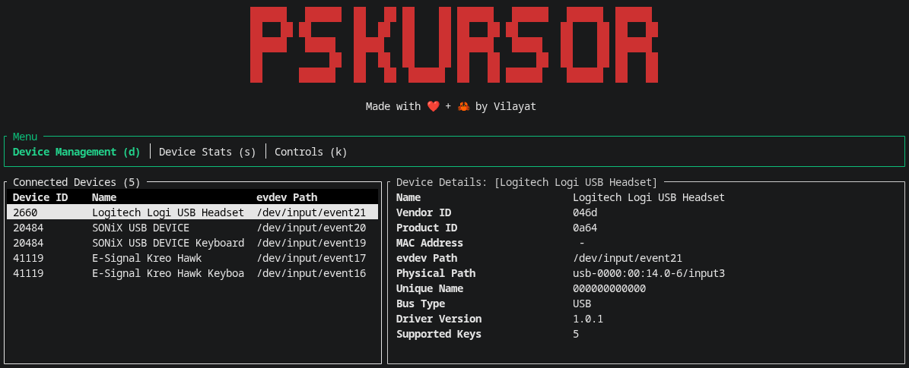
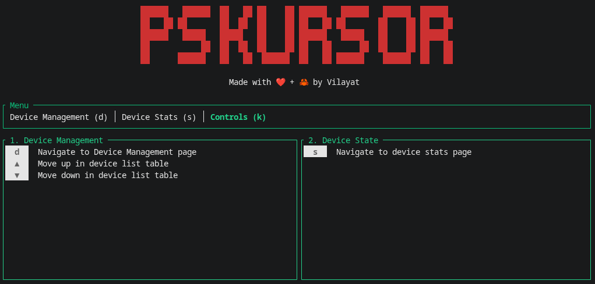

# pskursor

<div align="center">
    
</div>

**pskursor** is a simple Linux device driver written in Rust. It lets you use your gamepads and controllers to control your mouse cursor, making it fun to navigate your desktop without a mouse.

<hr />

## Features

1. Leverages HIDAPI for bluetooth and USB device detection.
2. Linux native api integration for mouse movement control.
3. Implemented in rust, so you know its blazingly fast...

<hr />

## Usage

```bash
# 1. Pick a controller: highlight it and press `y` to activate.
#    Only nodes marked ✓ in the Cursor column can drive the cursor.
pskursor --config

# 2. Run the daemon. Stick movement and button presses are logged by default.
pskursor

# Every raw evdev event, including SYN/MSC frames:
pskursor --verbose
```

Logging goes to **stderr** and defaults to `pskursor=debug`. `RUST_LOG` overrides
it when set:

```bash
RUST_LOG=pskursor=trace pskursor   # firehose
RUST_LOG=pskursor=info pskursor    # startup only, no per-event output
```

To see how pskursor classifies your devices without opening the TUI:

```bash
cargo run --example list_devices
```

### Composite controllers

A DualSense registers **three** event nodes and only the first can drive the cursor:

| Node | Name | Cursor capable |
| --- | --- | --- |
| `event22` | `DualSense Wireless Controller` | ✓ gamepad — sticks and buttons |
| `event23` | `… Motion Sensors` | ✗ accelerometer/gyro, no buttons |
| `event24` | `… Touchpad` | ✗ pointer, no gamepad buttons |

Activating a sibling node is the most common reason the daemon reports no
joystick events. pskursor rejects those nodes at activation *and* at daemon
startup, naming the capability that is missing.

### Device permissions

Reading `/dev/input/event*` requires membership of the `input` group:

```bash
sudo usermod -aG input "$USER"   # then log out and back in
```

<hr />

## Configuration

The active device is recorded in a **DEVAYNC** (Device Activation
Synchronization) file, resolved in this order:

1. `$PSKURSOR_CONFIG` — explicit file path, wins outright
2. `./devaync.json` — legacy location, used only if it already exists
3. `$XDG_CONFIG_HOME/pskursor/devaync.json`
4. `$HOME/.config/pskursor/devaync.json`

The XDG fallbacks matter because the daemon does not generally share a working
directory with the TUI.

<hr />

## Screenshots

### TUI - Device Management Screen (Main Screen)

<div align="center">
    
</div>

### TUI - Control Screen

<div align="center">
    
</div>

<hr />

## License

This project is licensed under the GNU General Public License, Version 2.

<hr />

<div align="center">
    Made with ❤️ by <a href="https://www.linkedin.com/in/syed-vilayat-ali-rizvi">me</a>
</div>